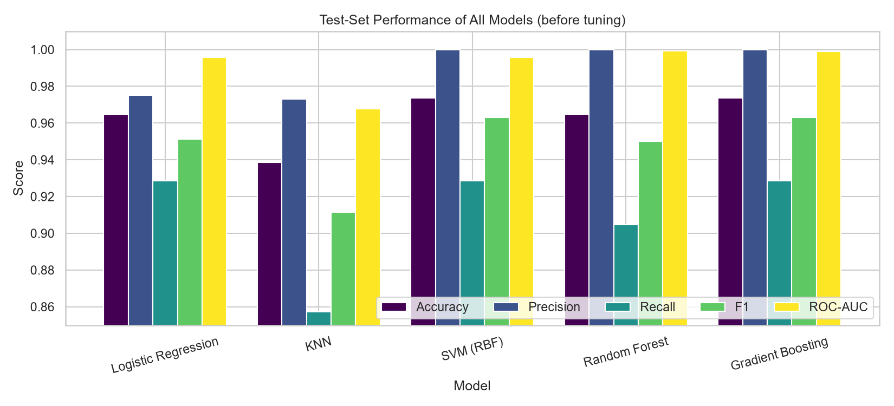
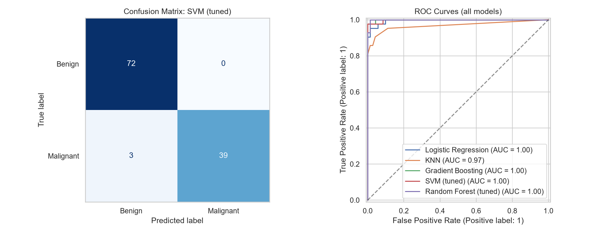

# Breast Cancer Prediction System

AIML Practical No. 10: AI/ML-Based Real-World Application (Disease Prediction)

**Group members:**  Sanket Kandalkar (TEITA30), Karan Jagtap (TEITA31), Chinmay Jadhav (TEITA27)

## Problem Statement
Predict whether a breast tumour is **malignant** or **benign** from measurements of cell nuclei taken from a fine-needle aspiration (FNA) biopsy. Early and accurate screening support can help clinicians prioritise cases. In disease prediction a missed cancer (false negative) is far costlier than a false alarm, so recall for the malignant class is closely monitored.

## Dataset
Breast Cancer Wisconsin (Diagnostic) dataset (UCI ML Repository), bundled with scikit-learn (`sklearn.datasets.load_breast_cancer`).
569 samples, 30 numeric features (mean, standard error and worst value of 10 nucleus properties), no missing values. Class split is about 63% benign / 37% malignant.

## Project Pipeline
1. Problem statement and objectives
2. Data quality checks and EDA (class balance, distributions, boxplots, correlation heatmap, outliers)
3. Stratified 80/20 train/test split; scaling inside a `Pipeline` (no data leakage)
4. Feature engineering (3 ratio features) and selection (ANOVA F-score ranking, removal of features with correlation above 0.95)
5. Models: Logistic Regression, KNN, SVM (RBF), Random Forest, Gradient Boosting
6. 5-fold stratified cross-validation and GridSearchCV tuning (SVM, Random Forest)
7. Evaluation: accuracy, precision, recall, F1, ROC-AUC, confusion matrix, ROC curves
8. Model selection by cross-validated F1 on training data (not test data)
9. Permutation feature importance, model saving, prediction demo

## Results (test set, 114 patients)
| Metric | Final model (tuned SVM) |
|---|---|
| Accuracy | 97.4% |
| Precision (malignant) | 100% |
| Recall (malignant) | 92.9% |
| ROC-AUC | 0.998 |

The model missed 3 of 42 malignant cases and raised no false alarms. Results can vary slightly with library versions.




## Repository Structure
```
.
├── breast_cancer_prediction.ipynb   # full project notebook
├── requirements.txt
├── README.md
├── images/                          # saved plots
└── models/breast_cancer_model.joblib
```

## How to Run
```bash
pip install -r requirements.txt
jupyter notebook breast_cancer_prediction.ipynb
```
Run all cells from top to bottom. Plots are saved to `images/` and the trained model to `models/`.

## Limitations and Future Work
- Small, single-source dataset; results may not generalise to other hospitals or equipment.
- A decision-support tool only, not a replacement for clinical diagnosis.
- Future work: external validation, probability calibration and threshold tuning to increase recall, SHAP explanations, and a Streamlit web app.
